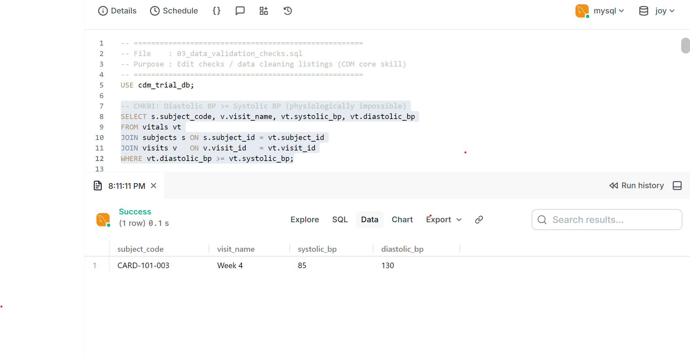
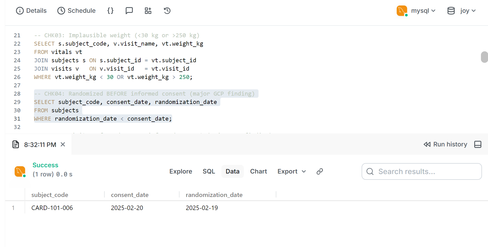
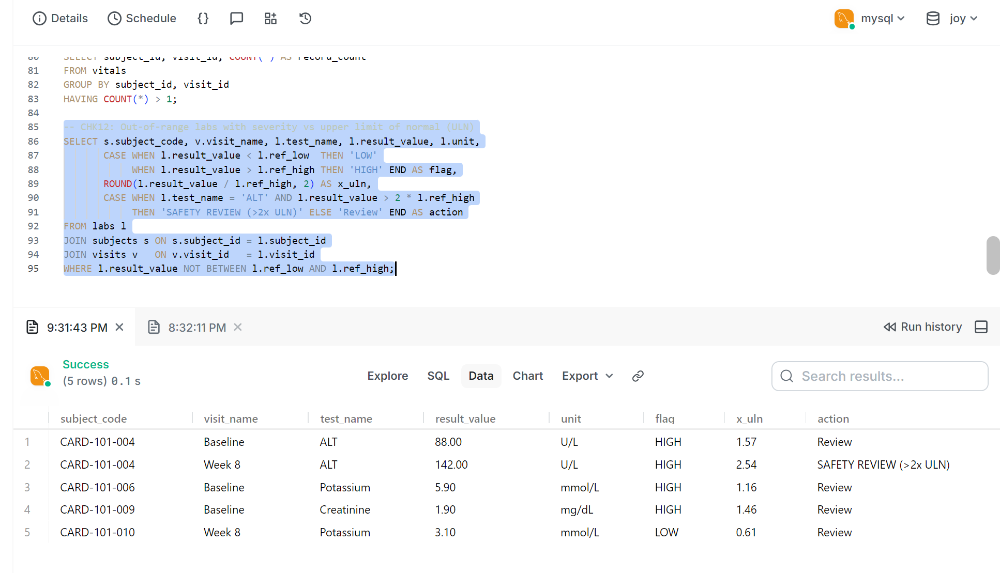
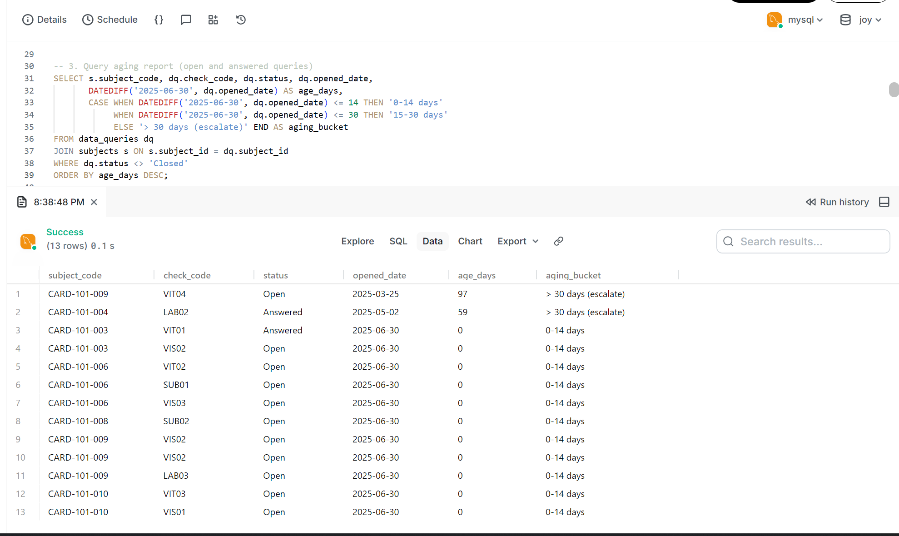
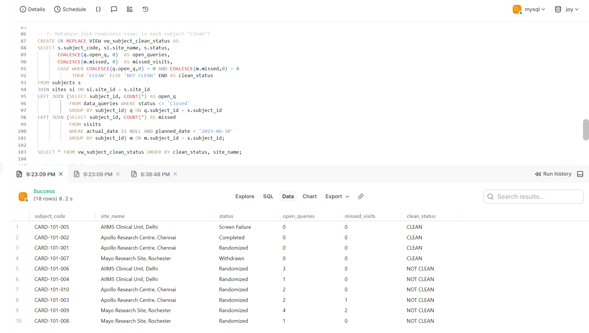

# CARD-101 Clinical Trial Data Management & Data Quality Monitoring (MySQL)

A SQL project simulating the data management workflow of a Phase III hypertension
clinical trial. It demonstrates Clinical Data Management (CDM) skills:
edit checks, query management, protocol deviation detection, and site performance monitoring.

> All data is **synthetic**. No real patient information is used.

## Business Problem
Clinical data managers must make sure trial data is accurate, complete and
GCP-compliant before database lock. This project builds the SQL layer to detect
data issues, raise queries, track resolution and report site performance.

## Database Design
6 tables: `sites`, `subjects`, `visits`, `vitals`, `labs`, `data_queries`

## What This Project Does
| Area | Details |
|------|---------|
| Edit checks (12) | BP logic, implausible HR/weight, duplicates, missing labs, date mismatches |
| GCP compliance | Randomization/visit before informed consent, age eligibility |
| Protocol deviations | Visit window (+/- 3 days), missed visits |
| Query management | Auto-generation of 12 data queries, status tracking, aging buckets |
| Site monitoring | Enrollment, screen-fail %, visit compliance, risk ranking |
| Lock readiness | `vw_subject_clean_status` view and % clean subjects |
| Safety flags | Labs outside range, ALT > 2x ULN flagged for safety review |

## SQL Concepts Used
Joins, CTEs, window functions (RANK), views, subqueries, CASE, conditional
aggregation, date functions (DATEDIFF, TIMESTAMPDIFF), UNION ALL, INSERT...SELECT, constraints and indexes.

## How to Run (MySQL 8+ / PopSQL)
Run the files in order: `01_schema.sql`, `02_sample_data.sql`, `03_data_validation_checks.sql`,
`04_query_management.sql` (run once only), `05_study_metrics_dashboard.sql`.

## Key Findings
- 10 subjects across 3 sites. 16 total data queries: 12 auto-generated and 4 historical.
- Only 33.3% of active subjects (3 of 9, excluding screen failures) are clean for database lock.
- Mayo Research Site (Rochester) has the highest query rate (2.0 queries per subject), followed by AIIMS Delhi (1.67) and Apollo Chennai (1.25).
- 3 major GCP findings: subject 006 randomized before consent, subject 010 screened before consent, and subject 008 aged 14 (below the 18-75 inclusion range).
- Subject 004 had ALT 142 U/L (above 2x ULN), flagged for safety review.
- 3 overdue visits at the 2025-06-30 cutoff (subjects 003 and 009).

## Screenshots

## Author
Vidyapogula Joycy | www.linkedin.com/in/vidyapogulajoycy | joycy.v28@gmail.com

